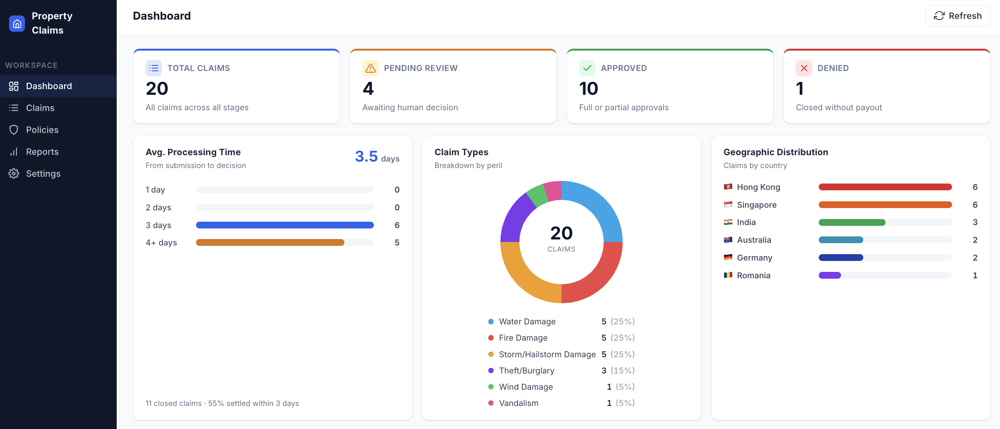
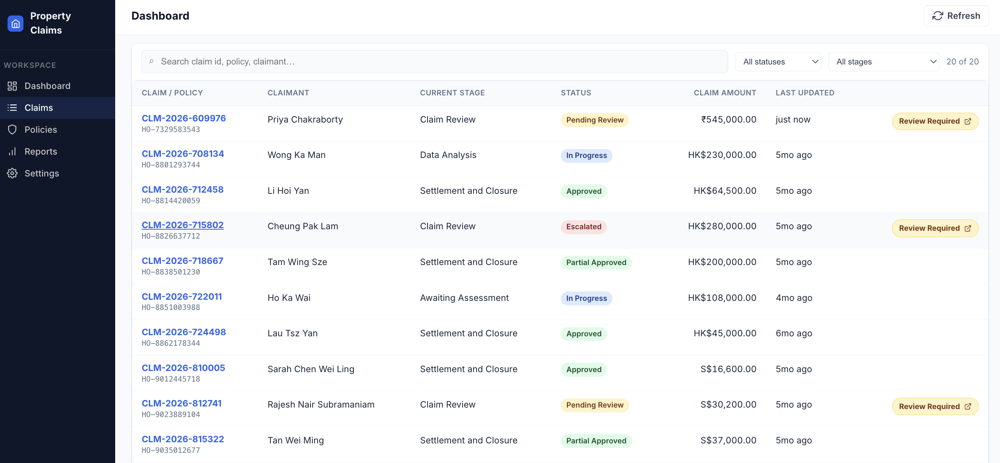

# The Process App — the intent is decided, the visuals are yours

What the standalone Coded Web App is for, which screens it has, and what data it can draw on — settled here so every seat builds the same product. **The screens and the data are the contract; which figures become cards, which distributions become charts, and how the page is composed is your design work.** Two mocks show the intent, not a pixel spec: [`mocks/dashboard.png`](mocks/dashboard.png) and [`mocks/claims.png`](mocks/claims.png).

`PDD.md` §11 is the requirement — a work queue, an SLA and ageing view, and a per-claim drill-down — and §4.4 PP5 is why: the only in-flight view today is a shared spreadsheet overwritten daily. `contracts/review-task.md` is what the gate task carries; `3f-validation/layout.md` is what a reviewer sees on one claim.

## One app, three screens

| Screen | Who | Shows | Reads |
|---|---|---|---|
| **Dashboard** | claims team lead, operations manager | the portfolio at a glance — how many, where, how old, what is waiting on a human, how it is being decided | the claim record (all rows, header columns) and the case (instance states, stage SLAs, pending tasks) |
| **Claims** | claims team lead | every claim, one row each: claim and policy, claimant, current stage, status, amount in its currency, last updated, and a *review required* mark where an Action Center task is open | the claim record's header columns; pending tasks joined on `claimId` |
| **Claim** | any handler | one claim in full, read-only: the stage strip, the checks with passes included, the settlement line by line, the recommendation and the decision, the letter, the three documents — and, **only while a gate task is open for it, the reviewer's decision controls** | the record by row id (the payload columns), the three documents from their buckets, the open task by `claimId` |

The dashboard and the claims list are the minimum. The claim screen reuses what `3f-validation/layout.md` fixed for the Action App — the same content, with the decision controls appearing only when a task is open — so a handler reviews from here or from Action Center and sees one thing.

## What the claim record carries

`contracts/claim-entity.md` is the schema — types, lengths and casings live there and nowhere else. This table says only what each column is **for** on the portfolio; the header columns do the work, the payload columns are for the claim screen only.

| Column | Type | Portfolio use |
|---|---|---|
| `claimId` · `policyId` · `claimantName` | string | the search — id, policy, claimant |
| `status` | string, your case's own lifecycle words | the status filter and every count by status; **the vocabulary is your `sdd.md`'s, and the app maps each word to a label** |
| `incidentType` | string | the claim-type distribution (six perils in the generator) |
| `propertyCountry` · `currency` | string | the geographic distribution (six countries); **amounts are never converted — sum per currency or not at all** (`PDD.md` A2) |
| `totalClaimAmount` | decimal | the claim amount, in its currency |
| `incidentDate` · `dateOfSubmission` | date | ageing from submission; the whole-claim SLA is counted from submission (`PDD.md` §5.5) |
| `reviewRequired` · `eligibilityDecision` · `reviewDecision` · `decisionReason` | boolean · strings | what was decided. **Who decided comes from the gate conditions, not the decision words**: the case's convergence write fills the decision columns on every claim, so read whether the screening checks all passed and whether `reviewRequired` was set — the gates opened must equal the tasks ever raised |
| `eligibilityReviewedAt` · `reviewedAt` | datetime | how long a gate waited; closed today |
| `CreateTime` · `UpdateTime` | system | *last updated*; time from open to close on a closed claim |
| `caseInstanceId` | string | the key into the case API |
| `eligibilityChecksJson` · `coverageChecksJson` · `assessmentReportValidationJson` · `settlementJson` · `payoutChecksJson` · `credibilityChecksJson` · `decisionJson` · `claimResponseJson` | JSON text | the claim screen — checks, settlement, recommendation, decision, the letter |
| `claimFormPdfName` · `policyPdfName` · `assessmentReportPdfName` | string | the three documents, read from their buckets |

**Two shapes to expect.** A column never written is absent from a row, not `null` — an in-flight claim is mostly absent columns. `decisionJson` is the recommendation envelope while the review gate is open and recommendation plus outcome after it closes.

## What the case knows that the record does not

| From | Gives | Needs |
|---|---|---|
| the case instance's stages (`CaseInstances.getStages`) | each stage's status and SLA state for one claim — the honest stage strip and the per-stage ageing §11 RP1 asks for | the Maestro scopes on the shared registration |
| the case process's instance counts | running / completed / faulted for the whole portfolio, pre-aggregated | the Insights scopes (`uipath-coded-apps` `references/oauth-scopes.md`), which the shared registration does **not** carry — compute these from the record |
| the pending Action Center tasks in your seat folder | *awaiting a human* (§11 RP2): which gate, since when, for which claim — after hydrating each task for its `claimId` | task read |

Everything the mocks show can be computed from the record alone; the case adds each stage's status through `getStages` (`PIMS`). Pre-aggregated counts and SLA roll-ups need Insights scopes the registration does not grant — compute them from the record and say on the screen what the case would have added.

## What §11 asks for, and where each lives

| §11 | View | Source |
|---|---|---|
| RP1 claims in flight | Claims list, filtered to open; ageing column | record; stages from the case where granted |
| RP2 awaiting a human | Dashboard card and list: open gate tasks with their age | pending tasks, hydrated |
| RP3 closed today | Dashboard card | `status` and `reviewedAt` / `UpdateTime` |
| RP4 SLA at risk | Dashboard: claims past a threshold of the whole-claim SLA; stage SLA where the case grants it | `dateOfSubmission` + `sdd.md`'s SLA; `getStages` |
| RP5 straight-through rate | Dashboard: closed claims where no gate opened, against the settled total | `reviewRequired`, `status` |

## The decision inside the app

A handler who opens a claim with an open gate task sees the same decision controls the Action App shows — two outcomes and a required reason at the first gate; the settlement line by line with overrides inside `PDD.md` §7.8 at the second. Submitting completes **that Action Center task** through the platform, with exactly what the contract says: the outcome as the task's action, the outputs, and the three identifiers replayed so the completed task still knows its claim. The case then writes the record and moves the claim on, exactly as if the decision had been made in Action Center. The app itself never writes the claim record.

Two rules come with it: find the task by its hydrated `claimId` and complete only that one, and offer the Action Center link beside the controls so a handler can take the same decision there instead.

## What is yours

Which cards and charts, the layout and navigation, polling or refresh, and how the claim screen shares code with the Action App at `Build/claim-review-<seat>/` — copy, a local package, a rewrite, or an alias into its source so there is one claim view and two deployables (the cookbook has the alias trap). What is not yours: the three screens, the record as the single source of the claim, the currency rule, the vocabulary coming from your own case, and a decision going through the task.
